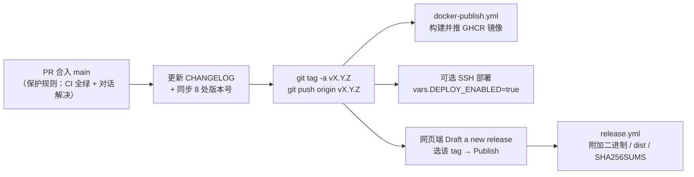

# 版本与发版规范

## 1. 版本策略

遵循 [语义化版本](https://semver.org/lang/zh-CN/) `MAJOR.MINOR.PATCH`，标签格式 `v<版本>`（如 `v1.0.1`）。

| 变更类型 | 版本位 | 示例 |
| --- | --- | --- |
| 破坏性 API / 表结构变更、不兼容的配置变更 | MAJOR | `1.0.0 → 2.0.0` |
| 向后兼容的新功能、新模块 | MINOR | `1.0.0 → 1.1.0` |
| 缺陷修复、依赖安全升级、文档与 CI 修订 | PATCH | `1.0.0 → 1.0.1` |

预发布用 `v1.1.0-rc.1`，在 GitHub Release 上勾选 pre-release。当前版本 **v1.0.0**（2026-11-14）。

## 2. 版本号同步清单

发版前必须逐项核对，任一遗漏都会造成产物与标签不一致：

| # | 文件 | 字段 |
| --- | --- | --- |
| 1 | `Cargo.toml` | `[package] version`（workspace 根包 `ERP`） |
| 2 | `erp-backend/Cargo.toml` | `[package] version` |
| 3 | `Cargo.lock` | 由 `cargo metadata` / `cargo build` 自动刷新，需提交 |
| 4 | `erp-frontend/package.json` | `"version"` |
| 5 | `erp-frontend/package-lock.json` | 顶层 `version` **与** `packages[""].version` 两处 |
| 6 | `CITATION.cff` | 若含 `version` / `date-released` 字段需同步 |
| 7 | `docs/CHANGELOG.md` | `Unreleased` → 新版本段落 + 日期 |
| 8 | `README.md` | 「当前版本」表述 |

一键核对：

```bash
grep -n '^version' Cargo.toml erp-backend/Cargo.toml
node -e "const p=require('./erp-frontend/package.json'),l=require('./erp-frontend/package-lock.json');console.log(p.version,l.version,l.packages[''].version)"
grep -A2 -E '^name = "(ERP|erp-backend)"' Cargo.lock
```

## 3. 发布流程（配置即代码）



### 3.1 打标签

```bash
git checkout main && git pull --ff-only
git tag -a v1.0.1 -m "v1.0.1 — <简述>"
git push origin v1.0.1
```

标签必须是**附注标签**（`-a`）；轻量标签不会出现在 Release 的 tag 说明中。

### 3.2 自动化动作

| 触发 | 工作流 | 产出 |
| --- | --- | --- |
| `push` tag `v*` | `docker-publish.yml` | 推 `ghcr.io/zimingys/rust_erp/erp-backend:vX.Y.Z` 与 `.../erp-frontend:vX.Y.Z`，并打 `latest`；生成构建摘要 |
| `release: published` | `release.yml` | 附加 `erp-backend-linux-x86_64-<tag>.tar.gz`、`erp-frontend-dist-<tag>.tar.gz`、`env.example`、`SHA256SUMS.txt` |
| 每周一 / push / PR | `security.yml` | 密钥扫描 + 依赖审计报告；PR 上的依赖差异审查 |
| PR / push 到 `main` | `ci.yml` | `backend`、`frontend` 两项必需状态检查 |

> `docker-publish.yml` 只监听 tag push，**不监听 release published**，避免同一版本重复构建两次镜像。

### 3.3 发布 Release

在 `Releases → Draft a new release` 选择**已存在**的 tag，标题 `vX.Y.Z — <简述>`，正文基于 `docs/CHANGELOG.md` 对应段落，并保留固定提示：

> 本项目采用 PolyForm Noncommercial 1.0.0：可自由学习与分享，禁止商业使用。
> 当前版本存在已记录的安全限制（见 docs/SECURITY.md），请勿部署到公网或用于生产环境。

Publish 后到 `Actions` 确认 `Release Assets` 成功，再回 Release 页核对 4 个附件齐全。

## 4. 自动部署（可选，默认关闭）

`docker-publish.yml` 内含 `deploy-ssh` job，仅当仓库变量 `vars.DEPLOY_ENABLED == "true"` 时执行，避免在没有服务器时误跑。

启用步骤：

1. 在目标服务器准备 Docker / Compose 与部署目录（参考 [deployment.md](deployment.md)）。
2. 仓库 `Settings → Secrets and variables → Actions` 添加：

| 类型 | 名称 | 说明 |
| --- | --- | --- |
| Variable | `DEPLOY_ENABLED` | `true` 才启用部署 job |
| Secret | `DEPLOY_HOST` | 服务器地址 |
| Secret | `DEPLOY_USER` | SSH 用户 |
| Secret | `DEPLOY_SSH_KEY` | 私钥（勿写入仓库） |
| Secret | `DEPLOY_PATH` | compose 所在目录 |
| Secret | `DEPLOY_PORT` | SSH 端口，默认 22 |

3. 部署 job 通过 SSH 登录，拉取对应版本镜像并 `docker compose up -d`，不触碰源码。
4. 首次启用建议先手动 `workflow_dispatch` 验证，再切到 tag 自动触发。

> 当前 `JWT_SECRET` 硬编码且服务不可公网部署，**开启自动部署前必须完成 [SECURITY_AUDIT.md](SECURITY_AUDIT.md) 的 P0 修复**。

## 5. 发版检查清单

- [ ] `main` 上 CI 全绿（`backend` / `frontend`）
- [ ] `docs/CHANGELOG.md` 已归档本版变更、已知限制已更新
- [ ] 8 处版本号一致，`Cargo.lock` / `package-lock.json` 已提交
- [ ] `cargo fmt --all -- --check`、`cargo test --workspace`、`npm run build` 本地通过
- [ ] `docs/SECURITY_AUDIT.md` 的审计数据已刷新（若改动了依赖）
- [ ] API / 数据库 / 模块文档随接口或表变更同步
- [ ] tag 为附注标签且与 Release 一一对应
- [ ] 镜像推送与 Release 产物工作流均成功

## 6. 回滚

| 场景 | 操作 |
| --- | --- |
| Release 说明写错 | 直接编辑 Release 正文，无需重打 tag |
| 产物构建失败 | 修 workflow 后对同一 tag 用 `workflow_dispatch` 重跑 |
| 版本有严重缺陷 | 发布新的 PATCH 版本修复；**不要删除或移动已发布 tag** |
| 误发布 | 在 Release 页标记 pre-release 或删除 Release 草稿，并在 CHANGELOG 注明 |
| 公开后发现凭据残留 | 见 [MAINTAINERS.md](MAINTAINERS.md#8-回滚预案) |

> 已推送的 tag 与镜像视为不可变；需要修正一律发新版本。
