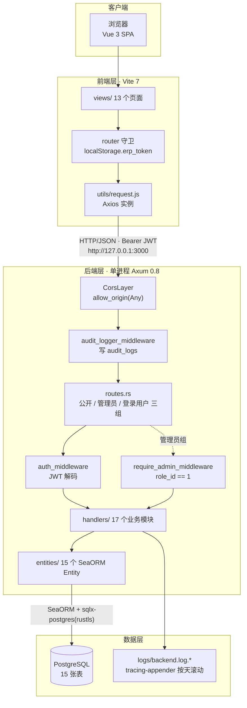

# 系统架构设计

> 本文描述 **v1.0.0 的实际实现**，不是理想设计。所有结论均可回溯到 `erp-backend/src/` 与 `erp-frontend/src/` 中的代码；与设计惯例不符之处统一列在 [已知架构约束](#已知架构约束与演进方向)。

## 1. 目标与范围

`Rust_ERP` 是一个面向毕业设计与教学演示的单体 ERP 系统：单个 Rust 二进制提供 REST API，单个 Vue 3 SPA 提供操作界面，PostgreSQL 承担全部持久化。系统覆盖采购、销售、库存、财务、基础资料、工作流、通知、审计与报表九类业务能力。

**非目标**：多租户、微服务、水平扩展、公网生产部署、真实业务数据承载。

## 2. 总体架构

### 分层职责

| 层 | 位置 | 职责 | 边界 |
| --- | --- | --- | --- |
| 表现层 | `erp-frontend/src/views/` | 页面渲染、表单校验、图表、路由跳转 | 只通过 `utils/request.js` 访问后端 |
| 接入层 | `erp-backend/src/routes.rs`、`middleware.rs` | 路由装配、CORS、审计、JWT 校验、角色判定 | 不含业务规则 |
| 业务层 | `erp-backend/src/handlers/` | 参数解析、业务编排、状态流转、导入导出 | **直接调用 SeaORM Entity**，无独立 service / repository 层 |
| 数据层 | `erp-backend/src/entities/`、`database.rs` | 实体映射、建表、连接管理、默认角色初始化 | 无迁移工具，DDL 由启动时 `Schema` 生成 |
| 基础设施 | `constants.rs`、`auth.rs`、`state.rs`、`permissions.rs` | 常量、令牌签发、共享状态、权限辅助 | 被上述各层直接引用 |

## 3. 请求生命周期

以 `POST /api/purchase-orders/{id}/approve` 为例：

1. 浏览器 Axios 拦截器注入 `Authorization: Bearer <token>`，请求 `http://127.0.0.1:3000`。
2. `main.rs:32-36` 的 `CorsLayer`（任意来源 / 方法 / 头）处理跨站预检。
3. `audit_logger_middleware`（`main.rs:43`）提取 method、path、`x-forwarded-for`、`user-agent`，自行解码 JWT 取 `user_id / username`，在响应返回后写入 `audit_logs`。
4. `routes.rs::create_router` 把请求匹配到 `protected_routes`；该组整体挂 `auth_middleware`。
5. `auth_middleware` 校验 Bearer 令牌签名与 `exp`，把 `UserClaims` 塞入请求 extensions；失败返回 `401`。
6. handler 执行审批逻辑，通过 SeaORM 读写 `purchase_orders`、`workflow_*` 等表，必要时生成通知或财务流水。
7. 响应经 `AppError` 统一转换为 HTTP 状态码与 JSON 错误体；Axios 响应拦截器直接返回 `response.data`。

> 中间件顺序以 `main.rs` 与 `routes.rs` 的 `.layer()` 调用为准：外层是 CORS 与全局审计，内层是分组鉴权；管理员组在鉴权之后再叠 `require_admin_middleware`。

## 4. 认证与授权

| 项 | 实现 |
| --- | --- |
| 令牌 | `jsonwebtoken` 默认算法（HS256）、`UserClaims { user_id, username, role_id, exp }`（`auth.rs:9-15`） |
| 有效期 | `TOKEN_EXPIRY_SECONDS = 86400`（24 小时，`constants.rs`） |
| 签发 | `POST /api/login` → `create_token` → `{ "token": "..." }` |
| 口令 | `argon2` + `password-hash`，仅存 `users.password_hash` |
| 校验 | `auth_middleware` 解码并校验；`require_admin_middleware` 判断 `role_id == ROLE_ADMIN(1)` |
| 角色 | `roles` 表三条固定记录：`1 管理员 / 2 主管 / 3 普通用户`（`database.rs::init_default_roles`） |
| 前端 | 令牌存 `localStorage.erp_token`；路由守卫只判断存在性，过期由 401 拦截器清理 |

**权限分组**（`routes.rs`）：

| 组 | 中间件 | 路径 |
| --- | --- | --- |
| 公开 | 无 | `/api/health`、`/api/register`、`/api/login` |
| 登录用户 | `auth_middleware` | 其余全部 `/api/*` 业务路由 |
| 管理员 | `auth_middleware` + `require_admin_middleware` | `/api/users*`、`/api/audit/*` |

> S-01：`JWT_SECRET` 是 `auth.rs:6` 的源码常量 `"your-secret-key"`，任何人可离线签发 `role_id=1` 的令牌。详见 [SECURITY.md](SECURITY.md)。

## 5. 状态与依赖管理

- `AppState { db: DatabaseConnection }`（`state.rs`）以 `Arc` 共享，通过 `with_state(state)` 注入全部路由；无全局可变单例。
- 数据库连接在 `main.rs` 启动时由 `database::initialize_database()` 建立，内部依次执行 `connect_db → init_tables → init_default_roles`。
- 连接串来自 `DATABASE_URL`（`dotenvy` 读 `.env`），缺失时 `expect` 直接 panic。
- 无连接池参数调优、无健康检查中的数据库探活（`/api/health` 只返回静态字符串）。

## 6. 数据与日志

- **持久化**：15 张表全部由 `database.rs::init_tables` 的 `Schema::create_table_from_entity(...).if_not_exists()` 创建，顺序见 [数据库设计](database.md#6-建表顺序)。表结构变更**不会自动迁移**。
- **审计**：所有经过中间件的请求写 `audit_logs`，含 `request_data` 字段；存在记录敏感参数的可能性（S-05）。
- **日志**：`tracing-appender` 按天滚动写 `logs/backend.log.*`，同时输出到 stdout；`logs/` 与 `**/logs/` 已被 `.gitignore` 忽略。
- **派生值**：仪表盘统计、库存预警、补货建议、安全库存等由 handler 在请求时实时计算，不落库（符合「原始状态持久化、派生值运行时计算」的原则）。

## 7. 部署视图

| 模式 | 组成 | 地址 |
| --- | --- | --- |
| 本地开发 | `cargo run -p erp-backend` + `vite dev` + 本机 PostgreSQL | 后端 `127.0.0.1:3000`，前端 `localhost:5173` |
| 容器编排 | `docker compose`：`postgres` + `backend` + `frontend(nginx)` | 前端 `:8080`，nginx 反代 `/api` 到 backend |

容器化有两处**必须由开发者自行修改**的硬编码，见 [deployment.md](deployment.md#52-部署前置修改必须自行完成)。

## 8. 工程化横切能力

| 能力 | 实现 |
| --- | --- |
| 构建门禁 | `ci.yml`：`backend`（fmt / check / test / clippy）、`frontend`（npm ci / build） |
| 安全门禁 | `security.yml`：密钥扫描、cargo-audit、npm audit、PR 依赖差异审查 |
| 发布 | `release.yml` 附加二进制与 dist；`docker-publish.yml` 推送 GHCR 镜像并预留 SSH 部署 |
| 依赖更新 | `dependabot.yml`：cargo / npm / github-actions / docker，minor+patch 分组 |
| 主分支保护 | 强制 PR、1 审批 + Code Owner、CI 必过、禁强推与删除、约束管理员，见 [MAINTAINERS.md](MAINTAINERS.md) |

## 9. 已知架构约束与演进方向

| 编号 | 现状 | 影响 | 演进方向 |
| --- | --- | --- | --- |
| A-01 | handler 直接操作 Entity，无 service 层 | 业务规则散落、难单测 | 抽 `services/`，handler 只做协议转换 |
| A-02 | 无数据库迁移工具，`if_not_exists` 建表 | 加字段不生效，环境间结构易漂移 | 引入 `sea-orm-migration` |
| A-03 | 金额字段 `f64` 与 `Decimal` 混用 | 浮点误差风险 | 统一 `rust_decimal` |
| A-04 | 时间字段 `String` 与 `DateTimeUtc` 混用 | 时区与比较语义不一致 | 统一 `DateTimeUtc` |
| A-05 | `JWT_SECRET` 硬编码、CORS `Any`、无限流 | 不可公网部署 | 环境变量注入 + 白名单 + 限流中间件 |
| A-06 | 仅监听 `127.0.0.1`、前端 `baseURL` 写死 | 容器与远程部署需改源码 | 监听地址与 API 地址配置化 |
| A-07 | 0 个自动化测试、clippy 有存量告警 | 回归无保障 | 先补 handler 层单测，再启用 `-D warnings` |
| A-08 | 审计与业务日志耦合在同一中间件 | 审计写入失败可能影响链路 | 异步队列 / 独立 sink |

> 架构决策优先级：**先补 A-05 / A-06 使部署可行，再补 A-02 使数据可演进，最后做 A-01 的分层重构。**
