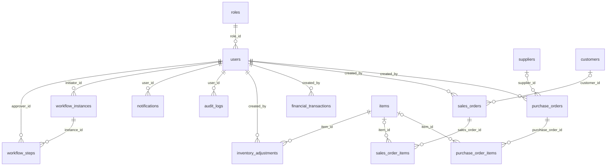

# 数据库设计

> 依据 `erp-backend/src/entities/*.rs`（15 个 SeaORM Entity）与 `erp-backend/src/database.rs::init_tables` 实测整理。字段类型以 Rust 定义为准，实际 PostgreSQL DDL 由 SeaORM `Schema` 生成，请以目标库 `\d` 结果为准。

## 1. 概述

| 项 | 值 |
| --- | --- |
| 数据库 | PostgreSQL（通过 `sqlx-postgres` + rustls 连接） |
| ORM | SeaORM 1.1，`ActiveModel` / `Entity` / `Relation` |
| 表数量 | **15 张** |
| 建表方式 | 启动时 `Schema::create_table_from_entity(...).if_not_exists()`，**无迁移文件 / 无版本管理** |
| 连接串 | `DATABASE_URL`（`dotenvy` 从 `.env` 读取） |
| 初始化数据 | `roles` 三条固定记录（ID 1/2/3），**不预置用户** |
| 时区类型 | `DateTimeUtc` 与 `String` 混用（见 [已知设计问题](#7-已知设计问题)） |

> ⚠️ `if_not_exists` 只保证「表不存在时创建」。**给已有表加字段不会生效**，必须手工 `ALTER TABLE` 或引入迁移工具。

## 2. 实体关系图



> 上述关系来自各 Entity 的 `Relation` 定义，是 **ORM 层关联**；SeaORM 的 `create_table_from_entity` 不保证生成数据库级 `FOREIGN KEY` 约束，因此应用层不依赖级联删除或引用完整性。`financial_transactions`、`workflow_instances` 通过 `related_order_id / business_id` + 类型字段做**弱关联**。

## 3. 表清单

| # | 表名 | 用途 | 主键 | 唯一约束 |
| --- | --- | --- | --- | --- |
| 1 | `roles` | 角色字典 | `id` | — |
| 2 | `users` | 用户账号与口令哈希 | `id` | — |
| 3 | `items` | 物品 / SKU / 当前库存 | `id` | — |
| 4 | `suppliers` | 供应商资料 | `id` | `supplier_code` |
| 5 | `customers` | 客户资料 | `id` | `customer_code` |
| 6 | `purchase_orders` | 采购订单主表 | `id` | — |
| 7 | `purchase_order_items` | 采购订单明细 | `id` | — |
| 8 | `sales_orders` | 销售订单主表 | `id` | — |
| 9 | `sales_order_items` | 销售订单明细 | `id` | — |
| 10 | `inventory_adjustments` | 库存变动流水 | `id` | — |
| 11 | `financial_transactions` | 收支流水 | `id` | — |
| 12 | `notifications` | 消息通知 | `id` | — |
| 13 | `workflow_instances` | 审批流程实例 | `id` | — |
| 14 | `workflow_steps` | 审批步骤 | `id` | — |
| 15 | `audit_logs` | 请求审计日志 | `id` | — |

## 4. 字段定义

类型列使用 Rust 类型；`?` 表示 `Option<T>`（可空）。

### 4.1 `roles`

| 字段 | 类型 | 说明 |
| --- | --- | --- |
| `id` | `i32` PK | 固定 1 管理员 / 2 主管 / 3 普通用户 |
| `name` | `String` | 角色名称 |

启动时 `init_default_roles` 以 `Set(id)` 写入三条；`insert` 失败被忽略（重复启动时幂等）。

### 4.2 `users`

| 字段 | 类型 | 说明 |
| --- | --- | --- |
| `id` | `i32` PK | |
| `username` | `String` | 登录名（Entity 未声明 unique） |
| `password_hash` | `String` | argon2 哈希，绝不存明文 |
| `role_id` | `i32` | → `roles.id`；`1` 为管理员 |

### 4.3 `items`

| 字段 | 类型 | 说明 |
| --- | --- | --- |
| `id` | `i32` PK | |
| `name` | `String` | 物品名称 |
| `sku` | `String` | 编码（Entity 未声明 unique） |
| `stock` | `i32` | 当前库存 |
| `description?` | `String` | |
| `unit?` | `String` | 单位 |
| `min_stock?` | `i32` | 低库存阈值，预警依据 |

### 4.4 `suppliers`

| 字段 | 类型 | 说明 |
| --- | --- | --- |
| `id` | `i32` PK | |
| `supplier_code` | `String` UNIQUE | 供应商编码 |
| `name` | `String` | |
| `contact_person?` / `phone?` / `email?` / `address?` | `String` | 联系信息 |
| `tax_number?` / `bank_account?` | `String` | 税务与银行信息 |
| `payment_terms?` | `String` | 付款条件 |
| `credit_limit?` | `Decimal` | 信用额度 |
| `rating?` | `i32` | 评分 |
| `status` | `String` | 状态 |
| `remark?` | `String` | 备注 |
| `created_at` / `updated_at` | `DateTimeUtc` | |

### 4.5 `customers`

与 `suppliers` 基本一致，差异：

| 字段 | 类型 | 说明 |
| --- | --- | --- |
| `customer_code` | `String` UNIQUE | 客户编码 |
| `credit_limit?` | `Decimal` | 信用额度 |
| `level?` | `String` | 客户等级（供应商表无此字段） |
| — | — | 无 `payment_terms` |

其余 `name / contact_person / phone / email / address / tax_number / bank_account / rating / status / remark / created_at / updated_at` 同供应商表。

### 4.6 `purchase_orders` / `sales_orders`

| 字段 | 类型 | 采购表 | 销售表 | 说明 |
| --- | --- | --- | --- | --- |
| `id` | `i32` PK | ✓ | ✓ | |
| `order_number` | `String` | ✓ | ✓ | 前缀 `PO` / `SO`（`constants.rs`） |
| `supplier_id?` / `customer_id?` | `i32` | ✓ | ✓ | 弱关联，可空 |
| `supplier` / `customer` | `String` | ✓ | ✓ | 冗余存名称快照 |
| `order_date` | `String` | ✓ | ✓ | 日期以字符串存储 |
| `expected_delivery_date` / `delivery_date` | `String` | ✓ | ✓ | |
| `status` | `String` | ✓ | ✓ | 见 [状态枚举](#5-状态与业务枚举) |
| `total_amount` | `f64` | ✓ | ✓ | ⚠️ 浮点金额 |
| `created_by` | `i32` | ✓ | ✓ | → `users.id` |
| `created_at` / `updated_at` | `String` | ✓ | ✓ | |

### 4.7 `purchase_order_items` / `sales_order_items`

| 字段 | 类型 | 说明 |
| --- | --- | --- |
| `id` | `i32` PK | |
| `purchase_order_id` / `sales_order_id` | `i32` | → 主表 `id` |
| `item_id?` | `i32` | → `items.id`，可空 |
| `item_name` | `String` | 名称快照 |
| `quantity` | `i32` | 数量 |
| `unit_price` / `total_price` | `f64` | ⚠️ 浮点金额 |
| `remark?` | `String` | |

### 4.8 `inventory_adjustments`

| 字段 | 类型 | 说明 |
| --- | --- | --- |
| `id` | `i32` PK | |
| `item_id` | `i32` | → `items.id` |
| `adjustment_type` | `String` | 入库 / 出库 / 盘点调整 / 损耗 / 退货 |
| `quantity` | `i32` | 变动量 |
| `before_stock` / `after_stock` | `i32` | 变动前后快照 |
| `reason?` | `String` | |
| `created_by` | `i32` | → `users.id` |
| `created_at` | `String` | |

### 4.9 `financial_transactions`

| 字段 | 类型 | 说明 |
| --- | --- | --- |
| `id` | `i32` PK | |
| `transaction_type` | `String` | 收入 / 支出 |
| `category` | `String` | 分类，用于 `get_category_summary` |
| `amount` | `f64` | ⚠️ 浮点金额 |
| `description?` | `String` | |
| `transaction_date` | `String` | |
| `related_order_id?` | `i32` | 弱关联订单 |
| `related_order_type?` | `String` | 订单类型 |
| `created_by` | `i32` | → `users.id` |
| `created_at` | `String` | |

### 4.10 `notifications`

| 字段 | 类型 | 说明 |
| --- | --- | --- |
| `id` | `i32` PK | |
| `user_id` | `i32` | → `users.id` |
| `title` / `content` | `String` | |
| `notification_type` | `String` (Text) | 库存预警 / 补货建议 / 订单审批 / 系统通知 |
| `is_read` | `bool` | |
| `priority?` | `String` | 高 / 中 / 低 |
| `related_id?` / `related_type?` | `i32` / `String` | 弱关联业务对象 |
| `created_at` | `DateTimeUtc` | |
| `read_at?` | `DateTimeUtc` | |

### 4.11 `workflow_instances` / `workflow_steps`

| 表 | 字段 | 类型 | 说明 |
| --- | --- | --- | --- |
| instances | `id` | `i32` PK | |
| | `workflow_type` | `String` | 流程类型 |
| | `business_id` / `business_type` | `i32` / `String` | 弱关联业务单据 |
| | `current_step` / `status` | `String` | 当前步骤与状态 |
| | `initiator_id` | `i32` | → `users.id` |
| | `created_at` / `updated_at` | `DateTimeUtc` | |
| | `completed_at?` | `DateTimeUtc` | |
| steps | `id` | `i32` PK | |
| | `instance_id` | `i32` | → `workflow_instances.id` |
| | `step_name` / `step_order` | `String` / `i32` | 步骤名与顺序 |
| | `approver_id?` / `approver_role_id?` | `i32` | 审批人或审批角色 |
| | `status` / `action?` / `comment?` | `String` | 状态、动作、意见 |
| | `created_at` / `updated_at` / `approved_at?` | `DateTimeUtc` | |

### 4.12 `audit_logs`

| 字段 | 类型 | 说明 |
| --- | --- | --- |
| `id` | `i32` PK | |
| `user_id` / `username` | `i32` / `String` | 由中间件自行解码 JWT 取得 |
| `action` / `module` | `String` | 动作与模块 |
| `method` / `path` | `String` | HTTP 方法与路径 |
| `ip_address?` / `user_agent?` | `String` | 取 `x-forwarded-for` / `x-real-ip` / UA |
| `request_data?` | `String` | ⚠️ 可能含请求参数与敏感信息（S-05） |
| `response_status` | `i32` | HTTP 状态码 |
| `description?` | `String` | |
| `created_at` | `String` | |

## 5. 状态与业务枚举

后端权威定义：`erp-backend/src/constants.rs`；前端平行定义：`erp-frontend/src/api/constants.js`。两处需手工同步。

| 类别 | 取值 |
| --- | --- |
| 角色 ID | `1` 管理员 / `2` 主管 / `3` 普通用户 |
| 采购订单 | `待审批` / `已审批` / `已取消` |
| 销售订单 | `待确认` / `已确认` / `已完成` / `已取消` |
| 库存调整 | `入库` / `出库` / `盘点调整` / `损耗` / `退货` |
| 工作流 | `待处理` / `等待中` / `已通过` / `已拒绝` / `已完成` |
| 通知优先级 | `高` / `中` / `低` |
| 通知类型 | `库存预警` / `补货建议` / `订单审批` / `系统通知` |
| 分页 | 默认 `10`、最大 `100`；订单号前缀 `PO` / `SO` |
| 其他参数 | JWT 有效期 86400s；服务因子 1.65；库存基准 30 天；补货目标 60 天；趋势 7 天 |

## 6. 建表顺序

`database.rs::init_tables` 按以下顺序执行（顺序反映依赖意图，但**未强制外键**）：

```
roles → users → items
→ purchase_orders → purchase_order_items
→ sales_orders → sales_order_items
→ inventory_adjustments → financial_transactions → audit_logs
→ suppliers → customers → notifications
→ workflow_instances → workflow_steps
```

`initialize_database()` 最后调用 `init_default_roles()` 写入三条角色。

## 7. 已知设计问题

| 编号 | 问题 | 影响 | 建议 |
| --- | --- | --- | --- |
| D-01 | 无迁移工具，`if_not_exists` 不更新已有表 | 加字段后旧库结构落后，环境漂移 | 引入 `sea-orm-migration`，DDL 版本化 |
| D-02 | 订单 / 流水金额用 `f64`，仅信用额度用 `Decimal` | 金额累加存在浮点误差 | 统一 `rust_decimal` |
| D-03 | 日期时间 `String` 与 `DateTimeUtc` 混用 | 排序、时区、比较语义不一致 | 统一 `DateTimeUtc` + `TIMESTAMPTZ` |
| D-04 | `username`、`sku`、`order_number` 未声明 unique | 可能产生重复账号 / 单号 | 加唯一索引 |
| D-05 | Relation 仅为 ORM 层，可能无数据库外键 | 孤儿数据、无级联约束 | 显式迁移中补 FK 或应用层校验 |
| D-06 | 主表同时存 `supplier_id` 与 `supplier` 名称快照 | 冗余、更新不同步 | 保留快照但明确语义为「下单时名称」 |
| D-07 | 除 unique 外无索引 | 大表查询 / 审计表查询变慢 | 为 `created_at`、`user_id`、状态字段建索引 |
| D-08 | `audit_logs.request_data` 可能记录敏感参数 | 日志泄露风险（S-05） | 写入前脱敏、设置保留期 |
| D-09 | 无软删除，删除即物理删除 | 误删不可恢复 | 关键表加 `deleted_at` |
| D-10 | 状态值以中文字面量散落在 Rust / JS 两处 | 前后端易漂移 | 改用枚举 + 接口下发字典 |

## 8. 初始化与备份

```bash
createdb erp_db
cp .env.example .env        # 填 DATABASE_URL，.env 已被忽略
cargo run -p erp-backend    # 自动建 15 张表 + 3 条角色
```

备份 / 恢复示例（含业务数据时注意脱敏）：

```bash
pg_dump -Fc erp_db > erp_db.dump      # *.dump 已被 .gitignore 忽略
pg_restore -d erp_db erp_db.dump
```

> 任何含真实数据的转储文件都**不得**进入 Git 仓库；`.gitignore` 已忽略 `*.dump`、`*.sql.gz`、`*.db`。
