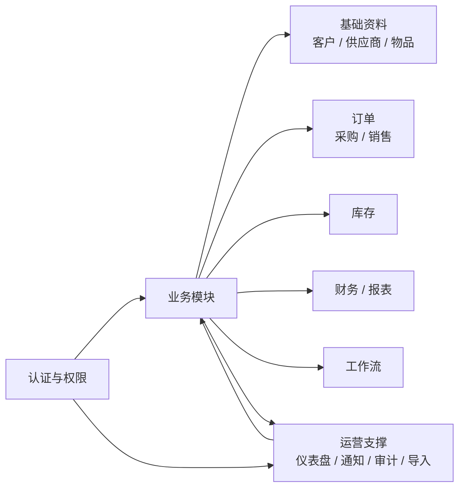
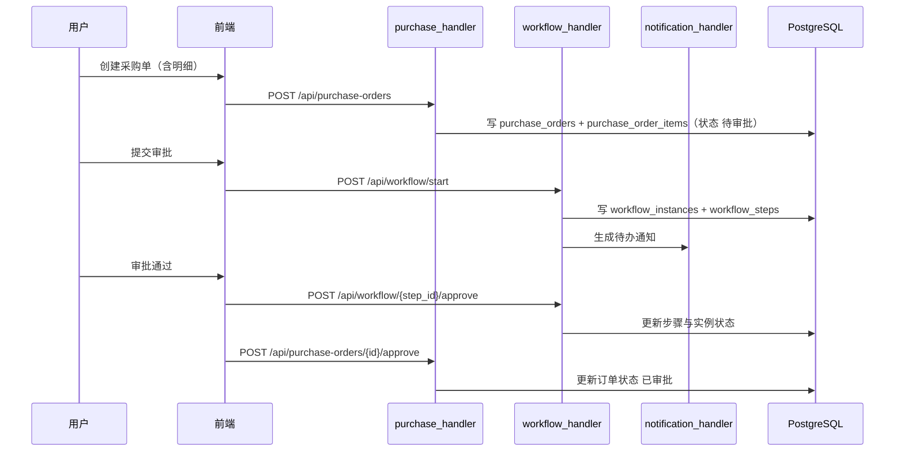

# 功能模块设计

> 模块划分以 `erp-backend/src/handlers/` 与 `erp-frontend/src/router/index.js` 的实际文件为准；接口清单见 [api.md](api.md)，表结构见 [database.md](database.md)。

## 1. 模块总览



系统按「**基础资料 → 单据 → 库存/财务 → 运营支撑**」四层组织，用户与角色是贯穿全局的横切依赖。

## 2. 后端模块清单

`erp-backend/src/handlers/` 共 20 个文件，其中 17 个业务模块、2 个基础设施（`error.rs`、`health.rs`）、1 个 `mod.rs`。

| 模块 | 文件 | 主要职责 | 关联表 |
| --- | --- | --- | --- |
| 认证 | `user_handler.rs` | 注册、登录、签发 JWT | `users`、`roles` |
| 用户与角色 | `user_management_handler.rs` | 用户 CRUD、角色列表、改密 / 重置口令 | `users`、`roles` |
| 客户 | `customer_handler.rs` | 客户 CRUD、客户统计 | `customers` |
| 供应商 | `supplier_handler.rs` | 供应商 CRUD、供应商统计 | `suppliers` |
| 物品 | `item_handler.rs` | 物品 CRUD、批量删除、库存调整 | `items` |
| 库存 | `inventory_handler.rs` | 库存列表 / 统计、调整历史、低库存预警、补货建议、安全库存计算 | `items`、`inventory_adjustments`、`notifications` |
| 采购 | `purchase_handler.rs` | 采购单 CRUD（含明细）、审批、取消、强制删除、供应商下拉 | `purchase_orders`、`purchase_order_items` |
| 销售 | `sales_handler.rs` | 销售单 CRUD（含明细）、确认、完成、取消、强制删除、客户下拉 | `sales_orders`、`sales_order_items` |
| 财务 | `finance_handler.rs` | 收支流水 CRUD、财务统计、分类汇总 | `financial_transactions` |
| 报表 | `report_handler.rs` | 采购 / 销售 / 库存 / 财务 / 审计五类 CSV 导出 | 多表 |
| 通知 | `notification_handler.rs` | 通知 CRUD、未读数、统计、单条 / 全部已读 | `notifications` |
| 仪表盘 | `dashboard_handler.rs` | 概览统计、销售 / 采购趋势、库存分布、Top 产品、财务摘要 | 多表（实时聚合） |
| 工作流 | `workflow_handler.rs` | 发起流程、审批步骤、我的待办、流程历史 | `workflow_instances`、`workflow_steps` |
| 审计 | `audit_handler.rs` | 审计日志查询 / 写入、用户活动汇总 | `audit_logs` |
| 导入 | `import_handler.rs` | 物品 / 供应商 Excel·CSV 导入、模板下载 | `items`、`suppliers` |
| 健康检查 | `health.rs` | 返回静态字符串，不探活数据库 | — |
| 错误 | `error.rs` | `AppError` 到 HTTP 响应的统一转换 | — |

## 3. 前端模块清单

`erp-frontend/src/views/` 共 13 个页面组件，路由与登录守卫集中在 `router/index.js`。

| 模块 | 路由 | 组件 | 主要后端依赖 |
| --- | --- | --- | --- |
| 登录 / 注册 | `/login`、`/register` | `Login.vue`、`Register.vue` | `/api/login`、`/api/register` |
| 仪表盘 | `/home` | `HomeDashboard.vue` | `/api/dashboard/*` |
| 物品管理 | `/products` | `ProductManagement.vue` | `/api/items` |
| 采购管理 | `/purchase` | `PurchaseManagement.vue` | `/api/purchase-orders*` |
| 销售管理 | `/sales` | `SalesManagement.vue` | `/api/sales-orders*` |
| 供应商 / 客户 | `/suppliers`、`/customers` | `SupplierManagement.vue`、`CustomerManagement.vue` | `/api/suppliers*`、`/api/customers*` |
| 库存管理 | `/inventory` | `InventoryManagement.vue` | `/api/inventory/*` |
| 财务管理 | `/finance` | `FinanceManagement.vue` | `/api/transactions*` |
| 报表导出 | `/reports` | `ReportExport.vue` | `/api/reports/export/*` |
| 审计日志 | `/audit` | `AuditLog.vue` | `/api/audit/*` |
| 用户管理 | `/users` | `UserManagement.vue` | `/api/users*`（管理员） |

`components/Layout.vue` 提供登录后的统一外壳；`api/constants.js` 集中路径与业务枚举；`utils/request.js` 是唯一网络出口。

## 4. 端到端模块映射

| 业务能力 | 前端视图 | 后端 handler | 主要 API 前缀 | 主要表 |
| --- | --- | --- | --- | --- |
| 登录与身份 | Login / Register | `user_handler` | `/api/login`、`/api/register` | `users`、`roles` |
| 权限管理 | UserManagement | `user_management_handler` | `/api/users` | `users`、`roles` |
| 基础资料 | Product / Supplier / Customer | `item_handler`、`supplier_handler`、`customer_handler` | `/api/items`、`/api/suppliers`、`/api/customers` | `items`、`suppliers`、`customers` |
| 采购 | PurchaseManagement | `purchase_handler` | `/api/purchase-orders` | `purchase_orders`、`purchase_order_items` |
| 销售 | SalesManagement | `sales_handler` | `/api/sales-orders` | `sales_orders`、`sales_order_items` |
| 库存与预警 | InventoryManagement | `inventory_handler` | `/api/inventory` | `items`、`inventory_adjustments`、`notifications` |
| 财务 | FinanceManagement | `finance_handler` | `/api/transactions` | `financial_transactions` |
| 报表 | ReportExport | `report_handler` | `/api/reports/export` | 多表 |
| 审批 | （订单页内触发） | `workflow_handler` | `/api/workflow` | `workflow_instances`、`workflow_steps` |
| 通知 | Layout 消息中心 | `notification_handler` | `/api/notifications` | `notifications` |
| 审计 | AuditLog | `audit_handler` + 全局中间件 | `/api/audit` | `audit_logs` |
| 仪表盘 | HomeDashboard | `dashboard_handler` | `/api/dashboard` | 多表聚合 |

## 5. 核心业务流程

### 5.1 采购订单审批



> 订单状态与工作流状态是**两套独立字段**，由不同 handler 分别更新，需靠调用顺序保证一致；没有事务包裹跨模块写入。

### 5.2 库存调整与预警

1. `POST /api/inventory/items/{id}/adjust` 或 `POST /api/items/{id}/stock` 调整库存。
2. 写 `inventory_adjustments` 记录 `before_stock / after_stock / adjustment_type / reason`。
3. `GET /api/inventory/alerts/low-stock` 按 `items.min_stock` 实时计算低库存；`POST /api/inventory/check-alerts` 主动生成通知。
4. `GET /api/inventory/reorder-suggestions` 依据 `constants.rs` 的 SERVICE_FACTOR_95、INVENTORY_DAYS_BASE、REORDER_DAYS_TARGET 计算建议量；`GET .../safety-stock` 计算安全库存。

### 5.3 销售订单状态机

```
待确认 ──confirm──▶ 已确认 ──complete──▶ 已完成
   │                    │
   └────cancel──────────┴──▶ 已取消
```

状态字符串定义在 `constants.rs`；采购单为 `待审批 → 已审批 / 已取消`。前端 `api/constants.js` 有一份平行的状态枚举，两处需手工保持一致。

### 5.4 导入与导出

- 导入：`POST /api/import/products`、`/api/import/suppliers`，`multipart` 上传 Excel（`calamine`）或 CSV（`csv`），模板由 `GET /api/import/template` 提供。
- 导出：`GET /api/reports/export/{purchase|sales|inventory|finance|audit}`，后端构造 CSV 返回文件流。

### 5.5 审计

所有经过 `audit_logger_middleware` 的请求在响应后写 `audit_logs`，字段含 `user_id / username / action / module / method / path / ip_address / user_agent / request_data / response_status`。`/api/audit/activity-summary` 做用户维度聚合。

## 6. 跨模块依赖与边界问题

| 依赖 | 说明 |
| --- | --- |
| `users` / `roles` → 全部 | 几乎所有写操作都带 `created_by` 或 `user_id`，但 ORM Relation 只覆盖部分表 |
| `items` → 订单明细 / 库存调整 | `item_id` 为可选（`Option<i32>`），明细同时冗余存储 `item_name` |
| 订单 → 财务流水 | `financial_transactions.related_order_id` + `related_order_type` 是弱关联，无外键 |
| 工作流 → 订单 | `workflow_instances.business_id` + `business_type` 是弱关联 |
| 库存 / 工作流 → 通知 | 预警与待办通过 `notifications` 表落地 |

**边界问题（当前实现）**

- 没有 service 层，handler 之间无法复用业务规则，跨模块写入无统一事务边界。
- 同一业务常量在 `constants.rs`（Rust）与 `api/constants.js`（JS）各存一份，存在漂移风险。
- 部分接口在前端常量与后端路由中路径不一致，见 [api.md](api.md#6-已知前后端契约偏差)。
- 「强制删除」类接口（`force-delete/{id}`）绕过状态约束，仅应在管理员上下文使用，但当前挂在 `protected_routes` 而非管理员组。

## 7. 扩展新模块的最小路径

1. `entities/<name>.rs` 定义 Entity → `entities/mod.rs` 导出 → `database.rs::init_tables` 追加建表。
2. `handlers/<name>_handler.rs` 实现 handler → `handlers/mod.rs` 注册。
3. `routes.rs` 挂到正确的权限组（涉及管理操作必须放 `admin_routes`）。
4. 前端加视图与路由、在 `api/constants.js` 补路径。
5. 同步更新本文、[api.md](api.md)、[database.md](database.md)、[CHANGELOG.md](CHANGELOG.md)。
6. 按 [CONTRIBUTING.md](CONTRIBUTING.md) 跑自检并开 PR。
